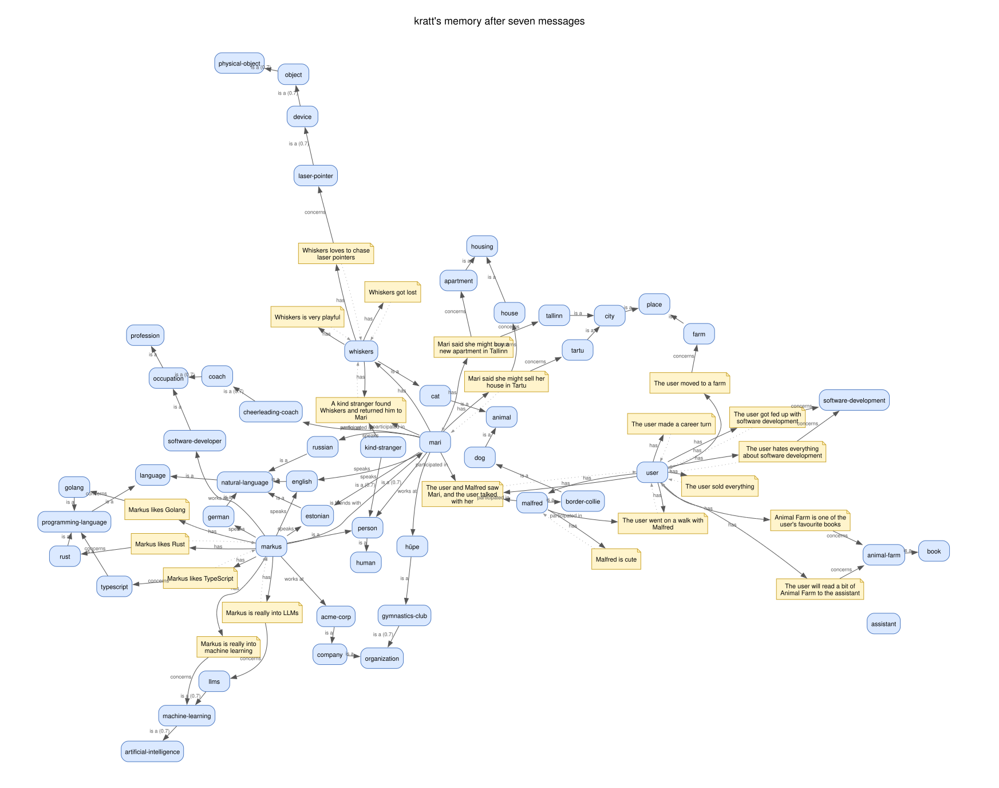
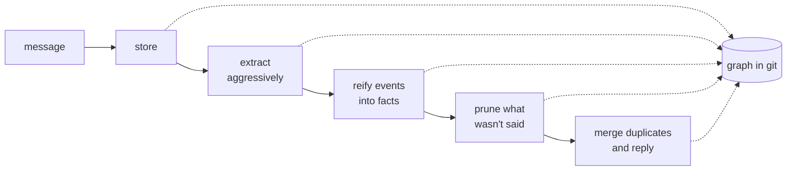

# kratt (v1) — archived

The first version of **kratt**, a personal research project on giving an AI
assistant a memory of its own. Built May–June 2026; kept here as a record. It
is not maintained.

**What it tried:** an LLM agent that writes its own memory as a graph while it
talks. Each message is answered, then mined for entities and facts, stored as
nodes and typed links — every link carrying *stability*, *confidence* and
*importance* scores, and a natural-language template for what it means. Later
passes extract aggressively, then prune what was not actually said. The graph
lives in its own git repo, one commit per memory step, and can be exported to
Graphviz, Gephi and TOON for inspection. It runs against Ollama, OpenRouter or
llama.cpp.

**Where it went:** the work continued in later, private versions. They moved
away from memory an LLM builds for itself — which drifts and fills with
confident junk — toward retrieval over notes a person writes, and toward
judging candidate notes with small decision models instead of generating new
memory.

`notes/vault-CLAUDE.md` is the full instruction set the memory agent followed.

## What it built

Seven made-up messages — a person introducing himself, a friend who coaches
cheerleading, a dog, a career change, a friend's cat — and the memory kratt
wrote for itself:



Blue boxes are entities, yellow notes are facts, dotted lines tie a fact to
what it is about, and a number on a link is a confidence below certain. Note
the two hubs, `markus` and `user`: from the third message on, the agent filed
the same person under a second name, and no later pass merged them — the
kind of quiet drift that pushed later versions away from LLM-built memory.

Every message runs through five passes, and each pass commits the graph:



Replaying those commits, message by message:



Re-run in October 2026 with `openai/gpt-6-luna` through OpenRouter, from
`docs/demo/messages.txt`; 12 of the 35 passes returned unparseable tool calls
and were skipped. Drawn with `python3 docs/render.py kratt-data docs` as two SVGs, 25 KB gzipped together: the animation draws each node and link once and switches it on per frame.

---

## Usage (as it was)

### env vars

| var                  | default                      | description                          |
| -------------------- | ---------------------------- | ------------------------------------ |
| `KRATT_BACKEND`      | `ollama`                     | `ollama`, `openrouter`, or `llamacpp` |
| `OLLAMA_MODEL`       | `lfm2.5`                     | model name for Ollama                |
| `OPENROUTER_API_KEY` | required                     | API key for OpenRouter               |
| `OPENROUTER_MODEL`   | `deepseek/deepseek-v4-flash` | model name for OpenRouter            |
| `LLAMACPP_URL`       | required                     | base URL of the llama.cpp server     |
| `LLAMACPP_API_KEY`   | required                     | API key for the llama.cpp server     |
| `LLAMACPP_MODEL`     | `default`                    | model name to pass to llama.cpp      |
| `LLAMACPP_MAX_TOKENS` | `8192`                      | max output tokens (caps reasoning runaway) |
| `KRATT_DEBUG`        | off                          | set to any value to log raw SSE stream |

```sh
# one-shot: pass prompt as argument
cargo run --bin kratt "your message here"

# one-shot: type when prompted
cargo run --bin kratt

# chat mode: persistent conversation loop
cargo run --bin chat

# run with openrouter
KRATT_BACKEND=openrouter cargo run --bin chat

# run with a different ollama model
OLLAMA_MODEL=qwen2.5:14b cargo run --bin chat

# run with llama.cpp
KRATT_BACKEND=llamacpp LLAMACPP_URL=http://localhost:8080 LLAMACPP_API_KEY=none cargo run --bin chat
```

## debug

```sh
# save output and debug log to separate files
cargo run --bin kratt "prompt" > >(tee output.log) 2> debug.log

# with raw SSE stream logging
KRATT_DEBUG=1 cargo run --bin kratt "prompt" > >(tee output.log) 2> debug.log
```

## viz

Converts a TOON graph file to GEXF, DOT, and SVG.

```sh
# convert live memory graph (default)
cargo run --bin viz

# convert a specific toon file
cargo run --bin viz path/to/file.toon

# open in gephi
open output/kratt-graph.gexf

# open rendered svg
open output/kratt-graph.svg
```

## graph_poc

Reads `kratt-memory/` → sled → petgraph → DOT / GEXF / TOON / SVG.

```sh
# run
cargo run --bin graph_poc

# open graph
open output/kratt-graph.svg

# open in gephi
open output/kratt-graph.gexf
```

### output files

| file                      | use                                |
| ------------------------- | ---------------------------------- |
| `output/kratt-graph.dot`  | graphviz source                    |
| `output/kratt-graph.svg`  | rendered graph (requires graphviz) |
| `output/kratt-graph.gexf` | Gephi import                       |
| `output/kratt-graph.toon` | LLM wire format (graph_poc)        |

### graphviz (optional)

```sh
brew install graphviz
dot -Tsvg output/kratt-graph.dot -o output/kratt-graph.svg
```

## memory (kratt binary)

Graph is stored in `kratt-data/` as its own git repo (gitignored by the main repo).
Each agent step that modifies the graph commits automatically.

```sh
# inspect memory history
git -C kratt-data log --oneline

# revert to empty state
git -C kratt-data checkout init -- kratt-graph.toon

# reset memory entirely
rm -rf kratt-data/
```

### cleanup

```sh
rm -rf kratt-graph.sled   # delete sled db
rm -rf output/            # delete graph_poc output
rm -rf kratt-data/        # delete memory graph and its git history
```
